# Dashboard UI: before / after (master plan Part C)

Screenshots by `python tools/ui_screens.py` (Playwright) on the ISOLATED QA server, with a throwaway QA test account and an empty data
folder. Phone 390x844 and laptop 1440x900. Before = code at 7388c1b (`before/`); after = this branch (`after/`).
The "Welcome to SINDHU" pop-up in both sets is the existing first-visit tour of a fresh account.

| Page | Before (laptop) | After (laptop) | After (phone) |
|---|---|---|---|
| Home | 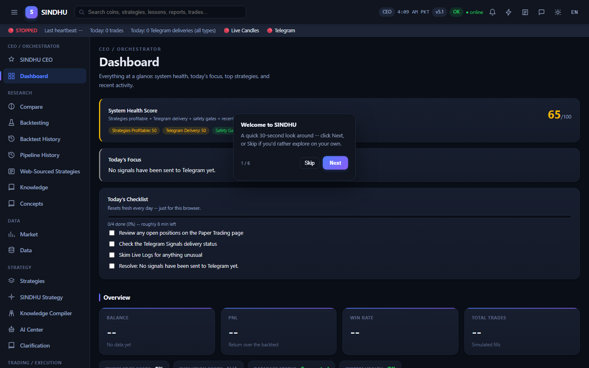 | 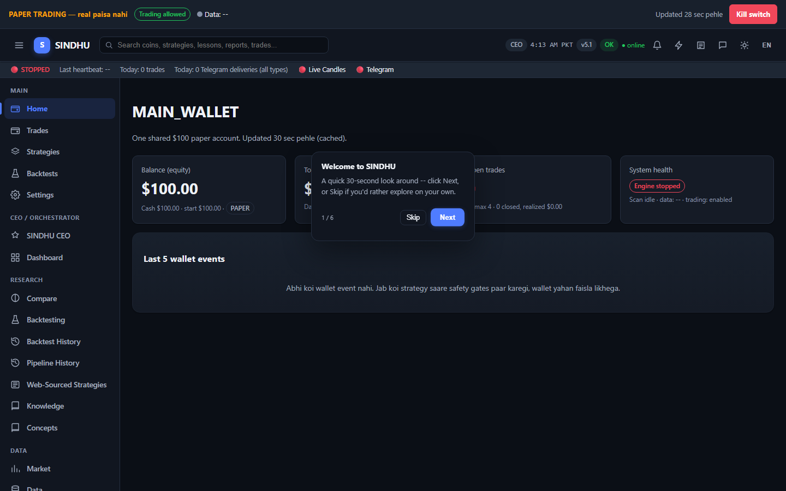 | 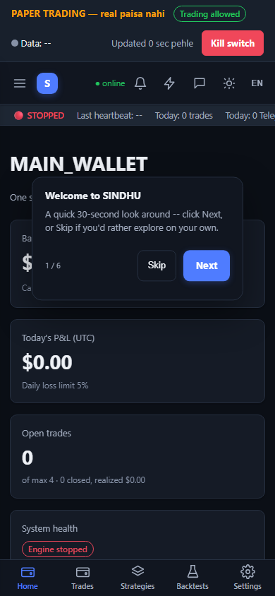 |
| Trades | 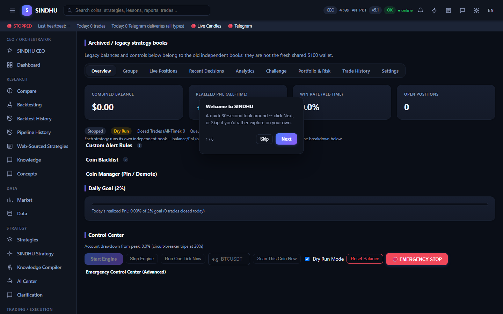 | 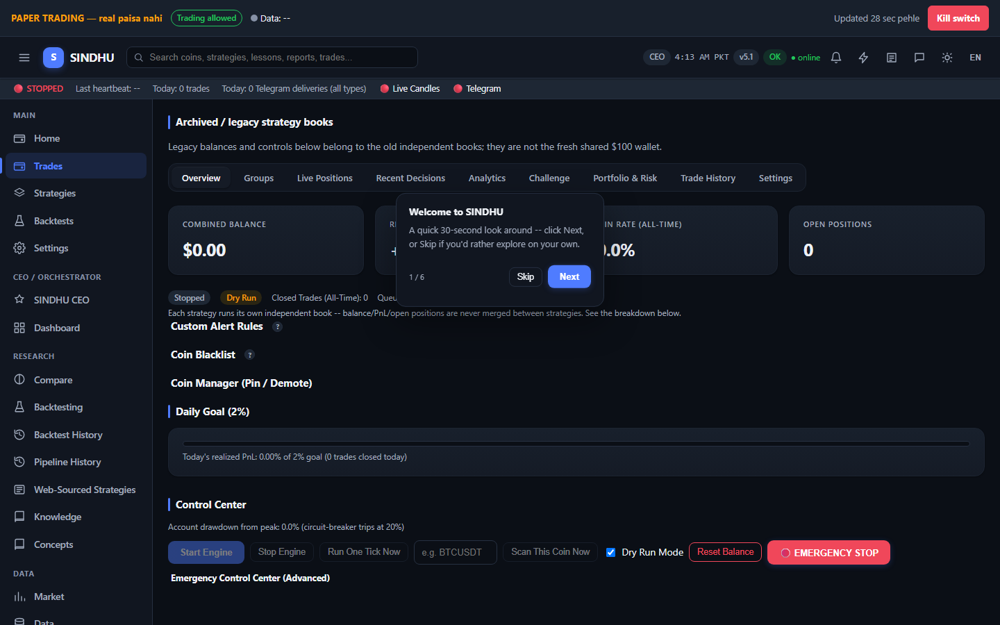 | 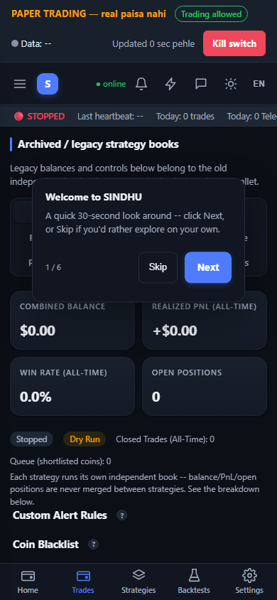 |
| Strategies | 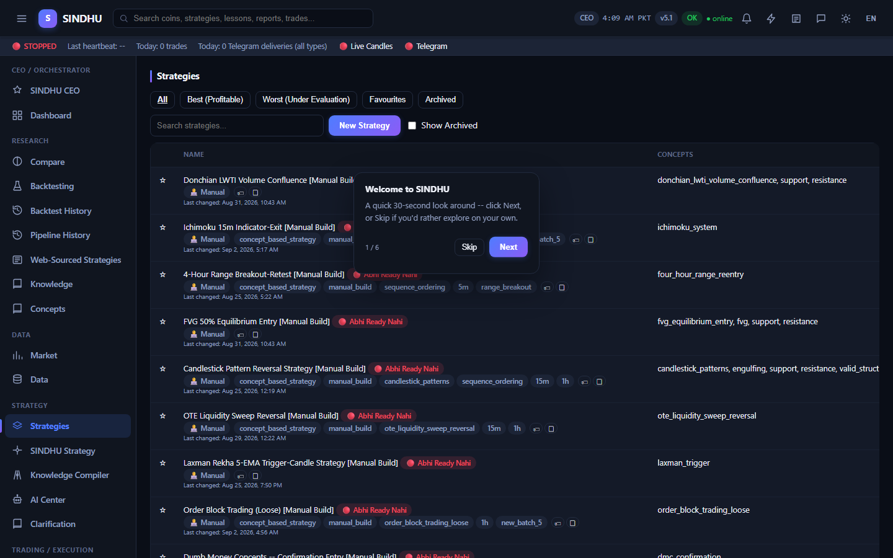 | 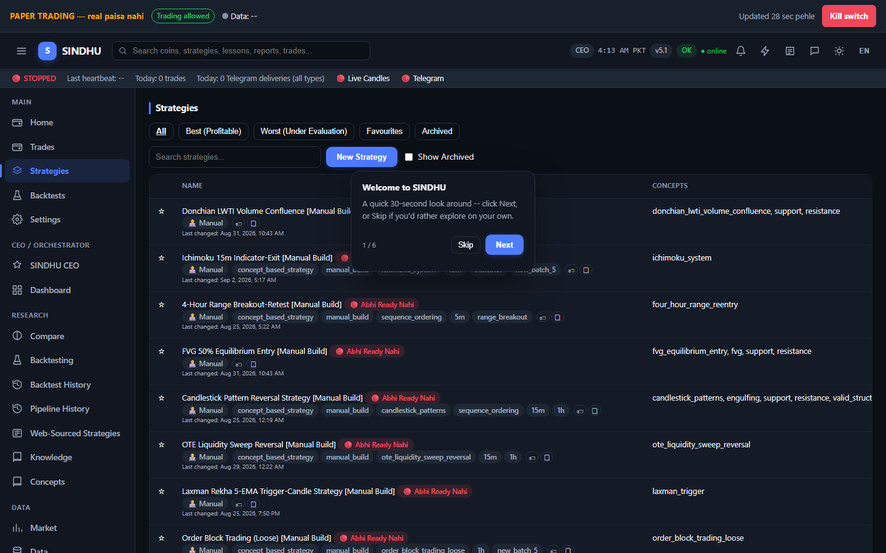 | 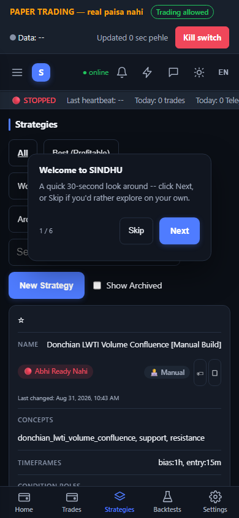 |
| Backtests | 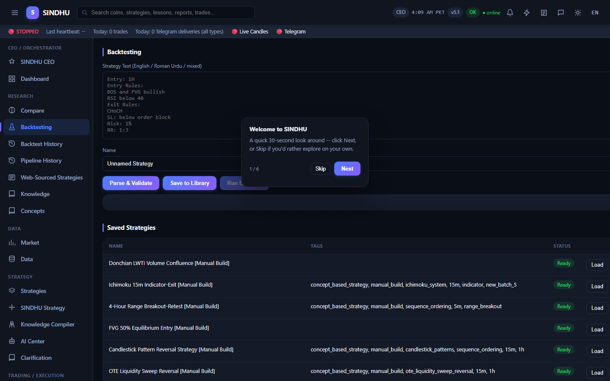 | 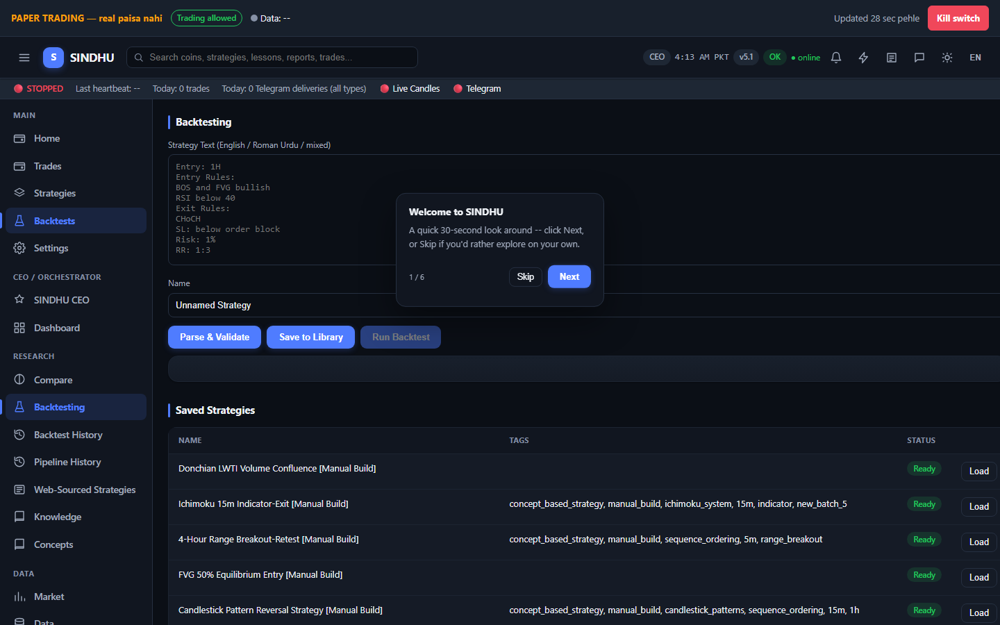 | 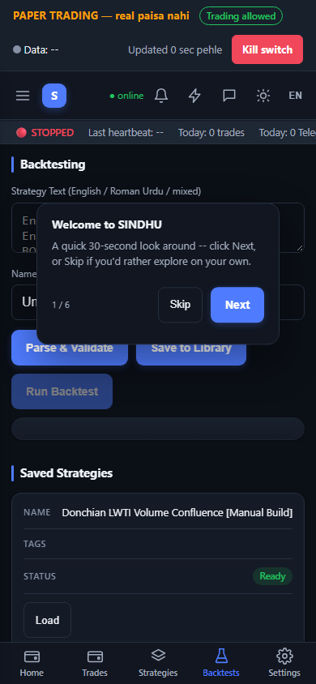 |
| Settings | 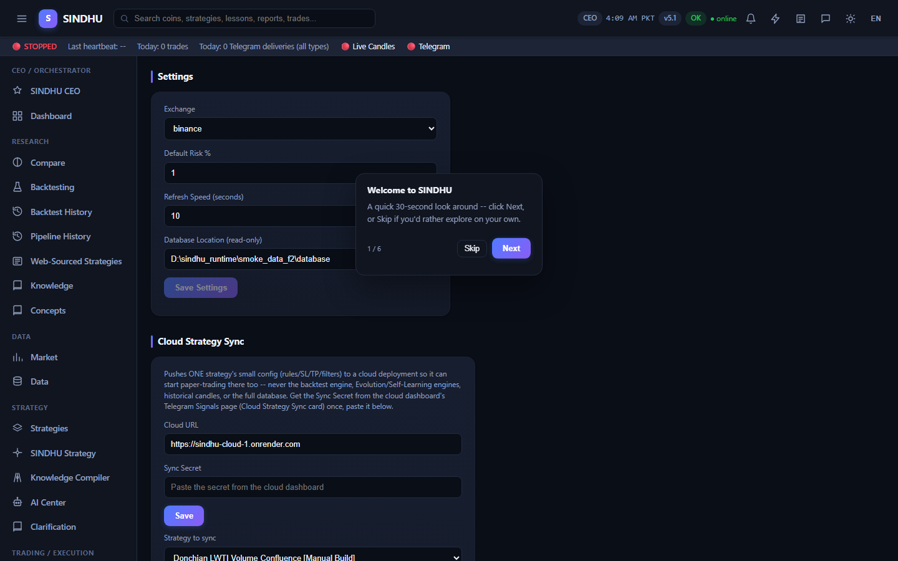 | 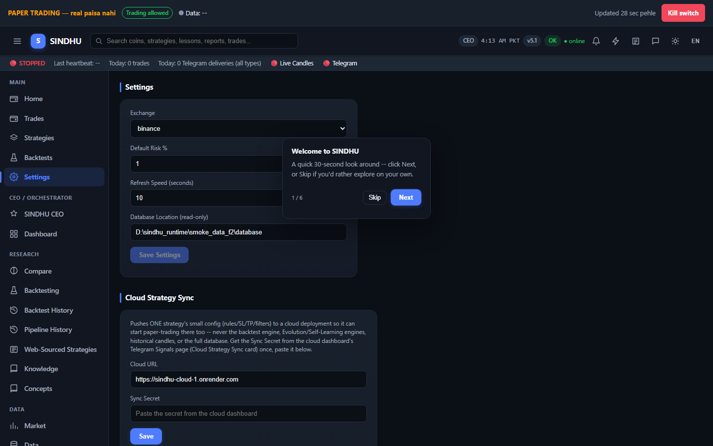 | 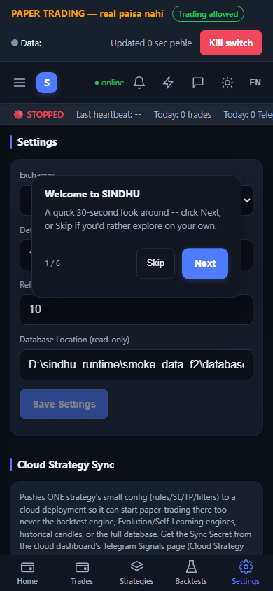 |

## Measured (tools/dashboard_baseline.py, 3 loads each, local QA server)
| Metric | Before (#home, 7388c1b) | After (#wallet) |
|---|---|---|
| Time until the network is quiet (median) | 3.04 s (first load 6.44 s) | 0.40-0.46 s |
| Requests per home load | 30 | 16 (-47 %) |
| API calls | 25 | 10 (-60 %) |
| Transferred | 1.1 MB | 261 KB (gzip, master plan C6) |
| Largest request | app.js 943 KB | app.js 238 KB (gzip) |
| Console errors (7 pages x 2 sizes) | 0 | 0 |
| Horizontal page scroll (7 pages x 2 sizes) | none | none |

Kill-switch button (`python tools/ui_killswitch_check.py`): Cancel sends nothing; Confirm activates with `close_positions: false`
(open positions keep their stops); Resume needs a second confirm. **PASS.**

## What changed (and what did not)
- **C1 (done):** `static/css/tokens.css` is the one token file (one accent, neutral greys, green = profit only, red = loss/danger,
  amber = warning, one font stack, 4/8 px spacing, radius, subtle shadows; "faint" text raised to AA contrast).
- **C2 (done):** permanent banner "PAPER TRADING -- real paisa nahi" with kill-switch state, data-freshness dot and kill-switch
  button. New Home = MAIN_WALLET (4 cards + last 5 wallet events) from one cached `/api/summary`. Five main sections first (Home,
  Trades, Strategies, Backtests, Settings) in the sidebar and in the phone bottom bar. All older pages are still reachable below them;
  none was removed.
- **C3 (partial):** text badges (PAPER, Data purana, KILL SWITCH ON, event types) and a sticky-header table on the new Home. The
  existing 50+ tables were NOT reworked (sort/filter/pagination unchanged).
- **C4 (partial):** skeleton cards, "Updated N sec pehle", 60 s refresh paused while the tab is hidden, on the new Home and the
  banner. No new chart library was added (no wallet equity chart yet).
- **C5 (partial):** human empty and error messages on the new Home and banner. The Settings page was NOT regrouped.
- **C6 (done for the new parts):** console-error and overflow checks, kill-switch interaction, performance before/after (above).
  Login works (all screenshots are behind the login gate). No full accessibility audit; focus outlines added.
